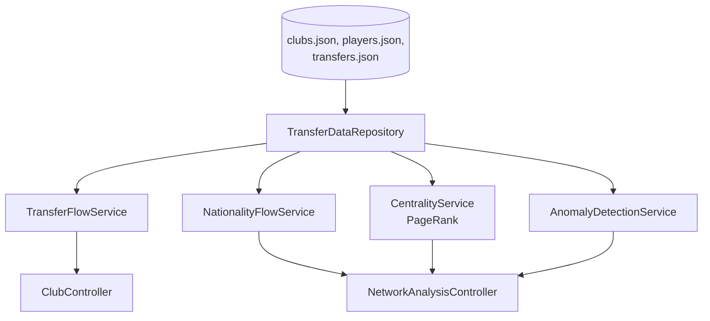

# Architecture

## Components

| Component | Responsibility |
|---|---|
| `TransferDataRepository` | Loads clubs/players/transfers once, serves from memory |
| `TransferFlowService` | Per-club spend/receive summaries, top club-to-club corridors |
| `NationalityFlowService` | Nationality → destination-league aggregation |
| `CentralityService` | Weighted PageRank over the transfer graph |
| `AnomalyDetectionService` | Fee outliers (IQR), transfer flurries, boomerang transfers |
| `ClubController`, `NetworkAnalysisController` | REST surface |

## Data Flow



### ASCII fallback

```
clubs.json + players.json + transfers.json
        |
        v
TransferDataRepository (in-memory, loaded once)
        |
   +----+----+----------+
   v         v          v
Flow    Nationality  Centrality   Anomalies
Service   Flow         (PageRank)  (IQR / flurry / boomerang)
   |         |             |            |
ClubController      NetworkAnalysisController
```

## Important Interfaces

- The transfer graph is never materialized as an explicit adjacency-list
  object shared across services — each service builds whatever
  aggregation it needs directly from `List<Transfer>`. At this data scale
  (336 transfers, 26 nodes) that's simpler than maintaining a shared graph
  structure, and every service stays independently testable.
- `CentralityService` and `AnomalyDetectionService` were both verified
  against independent Python reference implementations, run against the
  exact same JSON files, before being written in Java — see
  docs/design-decisions.md.

## External Dependencies

- Spring Web (runtime)
- Spring Boot Test (JUnit 5, AssertJ — test scope only)
- No graph database, no external graph library — see docs/design-decisions.md

## Decision Points

- **Why PageRank uses transfer *count* as edge weight, not fee**: a club
  that trades frequently with another (many loan/free moves, modest fees)
  is structurally central to the network in a way raw spend doesn't
  capture — and free/loan transfers (which carry a fee of 0) would be
  invisible to a fee-weighted centrality measure entirely.
- **Why anomaly detection ships three independent, named checks** rather
  than one generic "find weird things" function: each rule (IQR fee
  threshold, 30-day arrival window, revisited-club check) is independently
  understandable, independently testable, and independently disable-able —
  matching the same design philosophy as the E-commerce Revenue Detective
  project.
